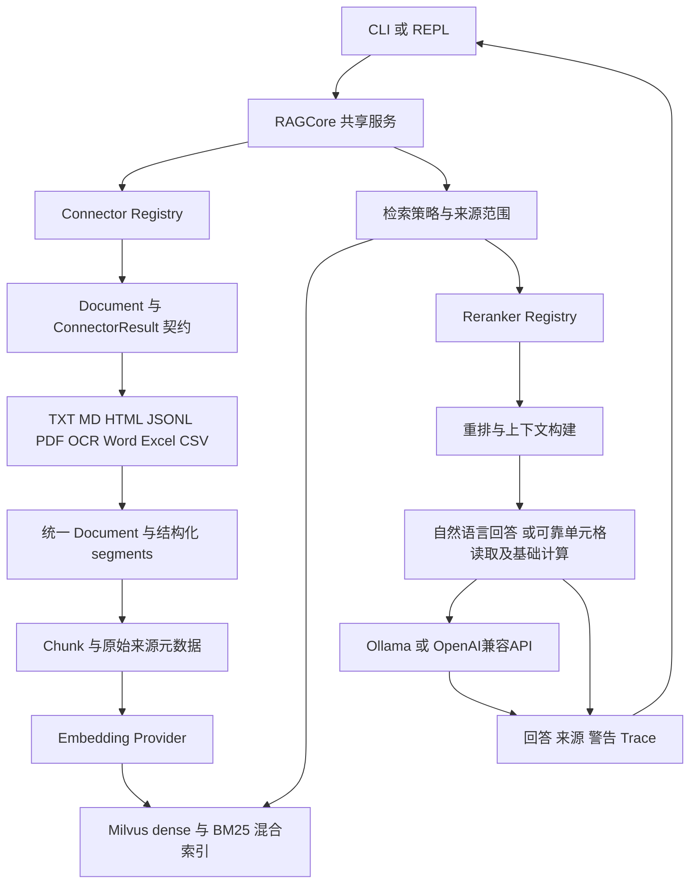

# RAG_multidocs

面向需要查询多种本地资料的学生、教师与项目组成员：导入文档，经插件解析、统一分块、检索和可选重排，输出带原始来源的问答结果。项目以 CLI/REPL 为入口，以 `RAGCore` 提供共享服务。

团队仓库：[H-wonder/RAG_multidocs](https://github.com/H-wonder/RAG_multidocs)。原始开源基线为 `f38a46de9ee250fe9b9cf7499b8cb1622a893a66`；在已有文档模型、Milvus混合检索、自然语言问答与CLI基础上，增量实现Connector/Reranker双插件、多模态及结构化解析、统一Core与运行管理。来源沿革见[第三方声明](project/THIRD_PARTY.md)。

用户已完成B版真实人工验收并选定该候选，核心功能开发结束；本次仅整理交付文件。B是未提交源码快照标识，**不是新的Git提交或正式发行标签**。当前已知局限保留，课程Review、最终CI和发行物仍需团队完成。

## 架构与工程贡献



正常Milvus路径不依赖SQLite Catalog，也不必经旧L1/L2/L3生成审核回路。已有旧实现保留兼容，不能当作当前默认架构。纯Milvus存储Chunk、向量及文档元数据；更新、缓存去重和普通异常补偿沿用现有服务。关键词后端仍是独立离线选项，并非Milvus数据的镜像。

- **Connector扩展点**：解析插件只返回公开 `Document/ConnectorResult/ConnectorIssue`；统一索引与问答无需逐插件适配。
- **Reranker扩展点**：只对既有候选ID排序，不能改原文或伪造来源；CrossEncoder支持宿主批准的常驻Worker。
- **统一Core**：CLI/REPL复用导入、检索、问答与来源契约；Embedding和Chat是Provider，不新增插件协议。
- **结构化证据**：保留行列、表头、单位、空字段、原始小数和位置；可靠单元格直接读取，有限运算使用Decimal。

## 环境安装

Python要求3.10及以上，现有验收环境为Python3.11。`rag`负责宿主、Milvus SDK、Embedding和Reranker；`docparse`负责PDF、Office及OCR解析，宿主通过子进程调用。以下安装供新环境部署，本轮不会执行下载或更换已验收环境。

从仓库根目录执行：

```bash
conda create -n rag python=3.11
conda activate rag
python -m pip install -e './project[dev,milvus,embed]'
python -m pip install Pillow

conda create -n docparse python=3.11
conda activate docparse
python -m pip install -r 已有资源/环境/requirements-docparse.txt
conda activate rag
```

`Pillow`用于图片插件的宿主依赖检查；`python-docx/openpyxl/PyMuPDF`等解析依赖安装在docparse环境。region布局模式还需Paddle/PaddleX，按[环境说明](已有资源/文档/07-环境搭建与依赖.md)的可选步骤准备，不是普通TXT/CSV必须依赖。

Milvus使用2.5+以支持服务端BM25。首次部署命令和持久化挂载见[环境说明](已有资源/文档/07-环境搭建与依赖.md#42-milvusdocker)；已有容器使用 `docker start milvus-standalone`。不要启动另一个容器覆盖现有数据目录。Milvus连接及Embedding维度必须与原集合一致。

本地Embedding使用现有 `BAAI/bge-small-zh-v1.5`；Quality的CrossEncoder默认读取已缓存 `BAAI/bge-reranker-base`，`local_files_only=true`，缺模型会告警回退，不能把回退当成功重排。扫描件OCR使用现有Ollama OCR模型与docparse；普通问答本地验收使用 `gemma3:4b`。部署前由维护者准备这些现有模型，仓库不携带权重。本轮不执行模型下载。

## 快速启动

以下命令从仓库根目录运行。首次创建**新配置**时复制模板；已有配置不要覆盖：

```bash
cp project/config.example.json project/config.json
```

编辑本地 `project/config.json`，填写实际Milvus集合、Embedding参数；`docparse_repo`可相对于该配置目录设置为 `../已有资源/可选组件/docparse`，`docparse_python`设置为docparse环境解释器的绝对路径。已有用户继续使用自己的配置路径和集合，勿用模板替换。

```bash
conda activate rag
PYTHONPATH=project/src python -m rag_multidocs --config project/config.json repl
```

REPL支持：

```text
/config
/stats
/connectors
/ingest auto project/samples/notes.txt project/samples/markdown
/search 检索器
/policy quality
/ask 文档如何描述检索器？
/trace
/model chat ollama gemma3:4b
/exit
```

来源随回答显示，`/search`查看命中，`/trace`核对实际重排执行模式、上下文来源和调用量。命中分数属于具体排序阶段，不是答案正确率。

对话API与密钥：

```bash
PYTHONPATH=project/src python -m rag_multidocs --config project/config.json keys set --provider dashscope
PYTHONPATH=project/src python -m rag_multidocs --config project/config.json models use --kind chat --provider dashscope --model deepseek-v4.1-flash-1017
PYTHONPATH=project/src python -m rag_multidocs --config project/config.json ask '文档的主要内容是什么？' --policy quality --trace
```

`dashscope`是此前DeepSeek验收使用的接入Provider；直接DeepSeek端点则选择 `deepseek` 并填写该端点实际支持的模型名，不能假定不同服务同名模型通用。`keys set`隐藏输入，密钥保存到配置指定的本地凭据文件；Shell环境变量优先。不要将密钥写入配置模板或Git。当前问答在生成结束后整段展示，`ask --stream`仅为兼容参数；**Core没有公开token回调接口**。

纯离线核心路径：把新配置的 `index_backend`设为`keyword`、`chat_provider`设为空，可导入TXT/Markdown/HTML/JSONL并检索，不需要Milvus或问答模型。CLI可按 `fallback_to_keyword` 在Milvus失败时告警回退；直接 `create_core` 不自动回退。回退后的知识库与Milvus不同，应先看实际backend，不能把空关键词索引当作Milvus数据丢失。

更多安装、命令、配置和排错见[使用说明](project/docs/USAGE.md)。

## 支持格式与边界

| 输入 | 实际入口 | 能力与限制 |
|---|---|---|
| TXT | 内置txt | UTF-8/BOM、常见中文编码及BOM标识Unicode读取；严格解码，不能保证所有未声明编码均无歧义 |
| Markdown / HTML | connector.markdown / connector.html | 文本、标题和可见正文；HTML不执行脚本、不爬取远程页面 |
| JSONL | connector.jsonl | 每行记录含text/source/title，可附公开blocks；逐行错误反馈，标准UTF-8 |
| 原生PDF | pdf | 文本及现有表格结构，保留来源与页码；复杂排版可能误读 |
| 扫描PDF / 图片 | pdf / connector.image | 使用现有OCR文字及可用布局；图片表格已有人工问答通过，不等于任意视觉关系理解 |
| Word | connector.word | DOCX正文、标题与表格；旧DOC不在专用插件声明范围 |
| Excel | connector.excel | XLSX多工作表、单元格显示/空值/表头/结构；公式缓存缺失明确反馈，不执行任意Excel公式引擎 |
| CSV | connector.excel | 标准库csv、UTF-8/BOM/GBK/GB18030，保留引号、空字段与字符串小数；可通过options指定编码/分隔符/表头行数 |

`auto`按插件Manifest后缀及优先级识别，支持单文件、多路径和递归目录。相同来源重新导入即更新；来源命名空间影响ID，移动文件或更换配置根目录时先核对来源身份。详见[Core接口](project/docs/RAG_CORE_API.md)。

## 四种检索策略

| 策略 | 现有实现 | 资源与适用说明 |
|---|---|---|
| Stable（默认） | 原混合召回、无重排，邻近片段补足；无改写/MMR/二次召回 | 常规问题的稳定基线；普通24候选、4块/2000证据token，摘要可6块/3000 |
| Lightweight | Stable加现有轻量重排插件 | 受信路径同进程；不加载CrossEncoder模型 |
| Quality | Stable加CrossEncoder | CLI Runtime授权常驻Worker；冷启动有模型加载开销，不保证每题优于Stable |
| Experimental | 现有自适应预算、MMR/覆盖、邻近、可选语义改写及二次检索 | 按事实/解释/综合选择12/24/48候选、2/4/6块及轻量/CrossEncoder；触发取决于问题和证据，不能保证每题都执行 |

证据token预算还受当前模型窗口/输出预留约束。四种策略共享自然语言问答和必要结构化读取，不采用不同复杂审核协议。用户Trace确认改写、二次检索、两种重排、Worker和多来源上下文实际运行；不宣称Experimental全面优于Quality。具体条件见[设计文档](project/docs/DESIGN.md)和[验收报告](project/docs/testing/FINAL_ACCEPTANCE.md)。

## 测试与开发

```bash
cd project
python -m pytest -q -m 'not integration'
python -m pytest tests/test_a_plus_plugins.py::test_independent_connector_full_flow_disabled_and_failure -v
python -m ruff check src tests connectors
```

这些是既有检查命令，不是本轮重新执行全部检查的声明。正常/边界/扩展契约覆盖见[验收报告](project/docs/testing/FINAL_ACCEPTANCE.md)；B版最新人工验收由用户执行。需要Milvus的测试仅在专用测试集合运行，禁止指向个人主库。故意引入错误的课程示例和现有CI缺口见[交付检查](project/docs/testing/DELIVERY_PREPARATION.md)。

新增Connector或Reranker按[插件协议](project/docs/RAG_PLUGIN_CONTRACTS.md)创建独立目录，配置允许列表/重排选择并重启进程。无需修改Core，无运行时热插拔或自动依赖安装。代码变更须另开分支，经真实成员Review确认后再合并；本次文档整理不提交、不推送、不创建PR。

## 成员贡献与AI核验

下表是待成员确认的责任入口，不以AI代替实际审查人，也不擅自认定未提交文件的作者。

| 成员责任 | 已确认工作范围 | Commit及实际审查记录 | AI建议与实际核验 |
|---|---|---|---|
| RAG Core及多模态扩展负责人（身份待本人填写） | 统一Core、双插件、结构化/OCR接入、持久化及问答必要修复 | c543949为恢复点；B增量未提交，审查人/意见/处理SHA待填 | 采用复用原能力及最小修复；用户完成真实REPL验收，局限保留 |
| CLI及交互负责人（身份待本人填写） | CLI/REPL、配置/模型切换和展示 | 历史代码存在；本次未修改CLI源码，个人Review记录待成员确认 | 由本人填写关键建议、验证及结论，未使用则写未使用 |
| 团队共同责任 | 独立扩展归属、Review、CI、制品及课程ZIP | 实际作者/审查人、关联SHA、意见与复核结论待补 | 不将自动检查或AI文字冒充真人Review |

README保留协作入口，未以推测补齐姓名、学号、Reviewer或CI成功记录。

## 许可与已知局限

项目代码沿用[MIT许可证](project/LICENSE)，便于复用与扩展；再分发应保留版权及许可。docparse所含第三方代码、模型和其他依赖各有独立许可，见[第三方声明](project/THIRD_PARTY.md)。docparse整体再分发许可仍需团队确认，不能将MIT自动套用到所有资源/权重。

长文档局部事实和整体预算可能召回不全；跨文档可能漏引用；模型可能漏答、混实体或编造。普通自然语言没有通用事实审核保障，`answered`不等于所有事实经语义验证。现有基础计算不是通用数学引擎；OCR只保证现有文字/布局能力，不保证复杂图形层级。当前不开发Agent、多轮记忆、权限/多租户、插件市场、热加载或任意图表推理。

## 文档与交付导航

- [文档总索引](project/docs/README.md)
- [给CLI同学的Core接口](project/docs/RAG_CORE_API.md) 与 [双插件公开协议](project/docs/RAG_PLUGIN_CONTRACTS.md)
- [系统设计](project/docs/DESIGN.md) 与 [课程设计文档DOCX](project/docs/DESIGN.docx)
- [B版最终人工验收](project/docs/testing/FINAL_ACCEPTANCE.md) 与 [任务书追踪](project/docs/RAG_REQUIREMENTS_TRACEABILITY.md)
- [Git与CI交付准备](project/docs/testing/DELIVERY_PREPARATION.md) 与 [历史摘要](project/docs/history/README.md)
- [原始环境资源](已有资源/环境/README.md) 与 [发布记录](release/RELEASE.md)
