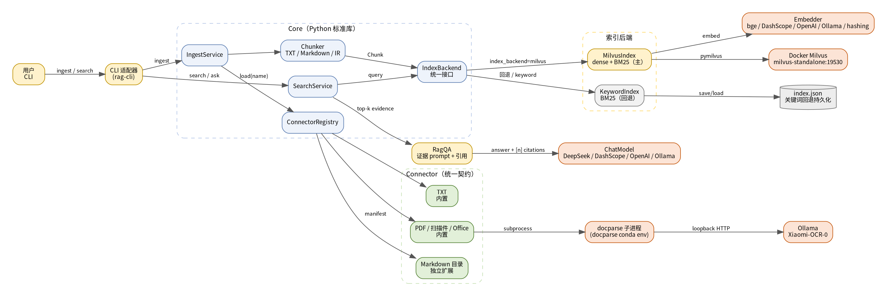
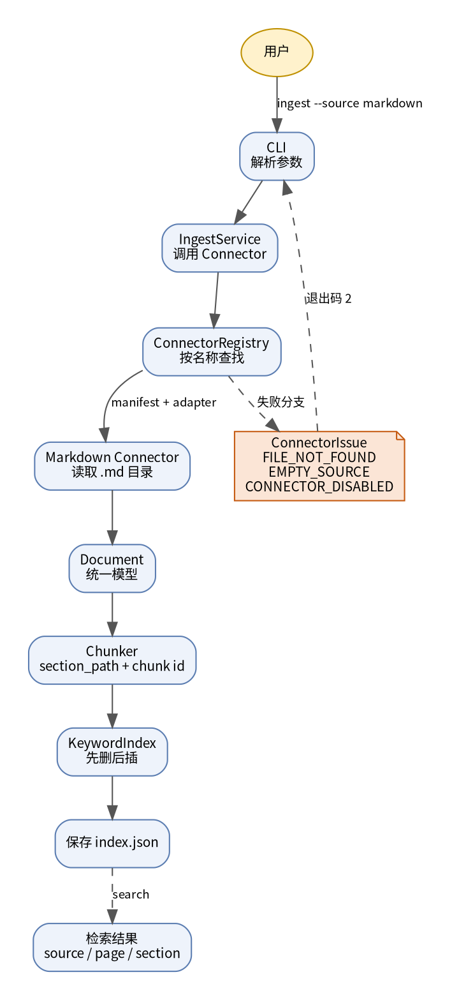

# RAG Multidocs——系统设计文档

> 项目：插件化多模态文档接入与检索平台
> 版本：0.1.0
> 仓库：<https://github.com/H-wonder/RAG_multidocs>
> 说明：本文档与 `src/`、`tests/`、`connectors/` 当前实现一致；提交版由本文导出为 `DESIGN.docx`。

## 1. 项目概述与需求

### 1.1 目标用户与问题

目标用户是需要检索课程资料的教师和学生。真实资料通常分散在 TXT 笔记、Markdown 文档、
PDF 论文和扫描件中。直接按文件翻找效率低；把资料简单拼成一个大文本又无法回答
“这句话来自哪个文件、哪一页、哪一节”。本项目要解决的是**统一接入与可溯源检索**：

- 用户指定数据源（TXT 文件/目录、Markdown 目录、PDF/扫描件、Office 文档）；
- 系统把不同格式转换为统一文档模型，切成可检索的块；
- 用户输入关键词，得到命中文本及其来源；
- 接入失败时返回明确错误，而不是静默跳过或崩溃。

### 1.2 核心使用场景

```text
用户执行：
  rag-cli ingest --source connector.markdown --path samples/markdown
  rag-cli search "表格怎么切块"

系统完成：
  Connector 读取目录 → Document（doc_id/source/title/正文）
  → Chunker 切块（section_path/page/确定性 chunk id）
  → IndexBackend：MilvusIndex（dense+BM25，主）/ KeywordIndex（回退）
  → 检索返回 text + source + page + section_path

用户得到：
  [1] 6.25  chunking.md  §切块策略 > 按结构切 > 表格
      表格必须整块保留。按字符数切会把一行数据切成两半……
```

**核心场景的完成条件**：

1. TXT 与 Markdown 两种来源都能导入；
2. 至少一条查询命中正确文档或片段，且返回 `source`；
3. 路径不存在、空文件、空目录、未知/禁用 Connector 均有结构化错误；
4. 禁用独立 Markdown Connector 后，TXT 导入与检索仍可用；
5. 上述行为由自动化测试断言，CI 可重复执行。

### 1.3 本次范围

**实现**：

- 统一 `Document` / `Chunk` 模型；
- 内置 TXT Connector（单文件或目录）；
- 内置 PDF/扫描件/Office Connector（通过外部 docparse 子进程，可选）；
- Milvus 混合检索（dense 向量 + 服务端 BM25），命中带来源；
- BM25 关键词索引与本地持久化，作为 Milvus 不可用时的回退；
- 嵌入后端：本地 bge-small-zh / DashScope / OpenAI / Ollama / hashing（CI 冒烟）；
- 检索增强问答：`rag-cli ask`，证据 + 引用式答案；
- Connector 注册表（内置 + manifest/adapter 插件）；
- 独立 Markdown 目录 Connector；
- CLI：`ingest/search/ask/models/docs/connectors/stats`；
- 测试、CI、README、设计文档、release 模板。

**不实现**：

- 用户登录、权限、多租户；
- 爬虫集群、插件市场、热加载；
- 生成式回答、复杂 Agent、模型评测；
- 把 Milvus/嵌入模型作为硬依赖（不可用时回退关键词）；
- 完整教务/校园业务系统。

## 2. 总体架构



### 2.1 模块与依赖方向

```text
CLI ──► Core（IngestService / SearchService / ConnectorRegistry）
             │
             ├── 内置 Connector：TXT、PDF/扫描件/Office
             ├── 独立扩展：Markdown 目录（manifest + adapter）
             └── IndexBackend
                   ├── MilvusIndex（dense + BM25，主）──► Docker Milvus
                   │        └── Embedder（bge / DashScope / hashing）
                   └── KeywordIndex（BM25，本地 index.json，回退）

CLI ask ──► SearchService ──► RagQA（证据 + [n] 引用）──► ChatModel
                                              （DeepSeek/DashScope/OpenAI/Ollama）

PDF Connector ──子进程──► docparse conda env ──loopback──► Ollama
```

| 模块 | 职责 | 依赖 |
| --- | --- | --- |
| `cli.py` | 参数解析、结果展示、退出码 | Core、Connector 实现 |
| `ingest.py` | 调用 Connector、切块、写入索引 | 契约、Chunker、Index |
| `search.py` | 查询索引并返回命中 | Index |
| `registry.py` | 按名称发现/加载内置与插件 Connector | 契约、manifest |
| `contracts.py` | `ConnectorConfig/Result/Issue/Error` 公开契约 | 无 |
| `model.py` | `Document`、`Chunk`、稳定 id | 标准库 |
| `chunking.py` | TXT/Markdown/IR 切块 | `model` |
| `index.py` | KeywordIndex：BM25、持久化、文档汇总 | `model` |
| `index_milvus.py` | MilvusIndex：dense+BM25、按 doc 先删后插 | `milvus_store`、`embedding` |
| `milvus_store.py` | Milvus schema/集合/混合检索封装 | pymilvus（可选） |
| `embedding.py` | Embedder 协议与 bge/DashScope/OpenAI/Ollama/hashing 实现 | sentence-transformers / 标准库 |
| `providers.py` | embedding/chat provider 预设、环境变量 Key 读取 | 标准库 |
| `llm.py` | OpenAI 兼容 Chat、证据 prompt、引用式答案 | 标准库 |
| `connectors/txt.py` | 内置 TXT 接入 | 契约、`model` |
| `connectors/pdf.py` | 内置 docparse 子进程接入 | 契约、`model` |
| `connectors/connector_markdown/` | 独立 Markdown 扩展 | 契约、`model` |

### 2.2 核心与扩展边界

- 核心只依赖 `Connector` 契约和 `Document`/`Chunk` 模型；
- 核心**不**按 `source_type` 写分支，只按 Connector 注册名查找；
- 独立扩展只依赖 `rag_multidocs.contracts` 和 `rag_multidocs.model`，
  不 import `IngestService`、`CLI`、索引后端的内部实现；
- 索引后端通过 `IndexBackend` 统一接口注入，Core 不按 Milvus/keyword 分支；
- PDF 解析放在外部进程，paddle/torch 等重依赖不进入核心环境；
- 新增数据源只需增加插件目录和 manifest，不修改 `src/rag_multidocs/`。

## 3. 模块设计

### 3.1 统一文档模型

```python
@dataclass
class Document:
    doc_id: str       # sha256(相对来源路径)[:12]
    source: str       # 相对路径/URI，检索结果必须回显
    content: str
    title: str
    media_type: str
    metadata: dict    # sha256、解析器信息、可选 docparse_ir
    segments: list

@dataclass
class Chunk:
    id: str           # sha1(doc_id:类型:序号)[:20]
    doc_id: str
    text: str
    source: str
    index: int
    content_type: str # text/table/code/formula/figure/page_text
    section_path: str # "3 Method > 3.2 Attention"
    page: int
    page_end: int
    bbox: str         # docparse 归一化坐标 JSON
    block_ids: list
    metadata: dict
```

`doc_id` 使用相对路径而不是绝对路径，换机器/换目录后增量索引用同一身份。
`chunk.id` 由 `(doc_id, 类型, 序号)` 决定，同一文档重跑得到同一批 id，索引层
“先删后插”即可幂等更新。

### 3.2 Connector 契约

```python
@dataclass(frozen=True)
class ConnectorConfig:
    name: str
    path: str
    options: dict

@dataclass
class ConnectorIssue:
    code: str       # FILE_NOT_FOUND / EMPTY_SOURCE / PARSE_ERROR ...
    message: str
    source: str = ""

@dataclass
class ConnectorResult:
    documents: list[Document]
    issues: list[ConnectorIssue]

class Connector(Protocol):
    name: str
    def load(self, config: ConnectorConfig) -> ConnectorResult: ...
```

错误约定：

| 情况 | 行为 |
| --- | --- |
| 路径不存在 | `FILE_NOT_FOUND`，CLI 退出码 2 |
| 文件为空 | `EMPTY_FILE`，跳过该文件，其他文件继续 |
| 目录没有匹配文件 | `EMPTY_SOURCE` |
| 单个文件读取失败 | `READ_ERROR`，记录来源，继续处理其他文件 |
| PDF 解析器不可用 | `CONNECTOR_UNAVAILABLE` |
| PDF/OCR 解析失败 | `PARSE_ERROR`，带解析器输出尾部 |
| 未知 Connector | `CONNECTOR_NOT_FOUND`，列出可用名称 |
| Connector 被禁用 | `CONNECTOR_DISABLED` |
| 插件抛未知异常 | `CONNECTOR_ERROR`，核心不崩溃 |

### 3.3 索引与检索

Core 只依赖统一的 `IndexBackend` 接口：

```python
class IndexBackend(Protocol):
    name: str
    def ensure_ready(self) -> None: ...
    def add(self, chunks, document=None) -> int: ...
    def remove_doc(self, doc_id: str) -> int: ...
    def search(self, query, top_k=5, doc_ids=None) -> list[dict]: ...
    def list_docs(self) -> list[dict]: ...
    def stats(self) -> dict: ...
    def persist(self) -> None: ...
    def close(self) -> None: ...
```

#### MilvusIndex（主检索）

- 嵌入：`Embedder` 协议；默认本地 `bge-small-zh-v1.5`（512 维），
  可选 DashScope `text-embedding-v4`（1024 维）或 `hashing`（CI/冒烟）；
- 写入：按 `doc_id` 先删后插；chunk 的向量输入带 `section_path` 前缀，
  存库文本仍是原文；
- 集合：`id/doc_id/version/text/source/page/page_end/section_path/bbox/sha256`
  + `dense`（HNSW/IP）+ `sparse`（服务端 BM25）；
- 检索：dense + BM25，`WeightedRanker(0.7,0.3)` 或 RRF；支持按 `doc_id` 过滤；
- 来源：命中返回 `source/page/section_path/content_type`，可选 bbox；
- 持久化：由 Milvus/Docker 卷负责，不写 `index.json`。

#### KeywordIndex（离线回退）

`KeywordIndex` 使用 BM25（k1=1.2, b=0.75）：

- 英文按小写词，中文按单字 + 连续中文串的二元组；
- 章节路径也参与索引，正文没写“切块”时仍可通过 `section_path` 召回；
- 文档长度参与归一化，短块不会因为词频高而绝对占优；
- `save/load` 使用 JSON；`persist()` 由 IngestService 调用；
- 当 `index_backend=milvus` 但 Milvus/嵌入不可用，且
  `fallback_to_keyword=true` 时，CLI 打印 WARN 并切到该后端。

命中结构统一：

```json
{
  "chunk_id": "...",
  "score": 0.032,
  "doc_id": "...",
  "source": "guide.md",
  "text": "...",
  "page": 3,
  "section_path": "切块策略 > 表格",
  "content_type": "text"
}
```

### 3.4 检索增强问答

`rag-cli ask` 的流程：

```text
question
  → SearchService 取 top-k 证据（Milvus 或 keyword）
  → build_messages：系统指令 + 编号证据（[1] source p# §section）
  → ChatModel.complete
  → answer + citations
```

- 没有命中证据时**不调用 LLM**，直接返回“没有检索到相关依据”；
- 系统提示要求只依据证据回答、用 `[n]` 引用、证据不足时明确说明；
- 返回的 `citations` 包含 `index/chunk_id/doc_id/source/page/section_path`；
- API Key 只从环境变量读取：`DEEPSEEK_API_KEY`、`DASHSCOPE_API_KEY`、
  `OPENAI_API_KEY`；Ollama 不需要 Key；
- provider/model 可通过 `--provider/--model` 临时覆盖，或
  `rag-cli models use` 写入 `config.json`（不写 Key）。

### 3.5 CLI 适配器

| 命令 | 作用 | 失败行为 |
| --- | --- | --- |
| `rag-cli ingest --source NAME --path P` | 导入数据源 | 无文档时退出码 2，打印 issues |
| `rag-cli search Q --top-k N` | 检索并显示来源 | 无命中打印 `no hits`，退出码 0 |
| `rag-cli ask Q` | 检索 + LLM 生成 + 引用 | 未配置 chat provider 退出码 2；无证据不调用模型 |
| `rag-cli models list/use` | 查看/选择 provider 与模型 | 未知 provider 退出码 2 |
| `rag-cli docs list` | 已索引文档汇总 | 空索引提示 `no documents` |
| `rag-cli connectors list` | 内置/插件与启用状态 | — |
| `rag-cli connectors enable/disable NAME` | 修改配置并持久化 | 未知名称退出码 2 |
| `rag-cli stats` | 块数/词项数/文档数 | — |

## 4. 扩展机制与接口设计

### 4.1 插件目录与 manifest

```text
connectors/connector_markdown/
├── manifest.json
├── adapter.py
└── README.md
```

```json
{
  "name": "connector.markdown",
  "version": "0.1.0",
  "description": "递归读取 Markdown 目录",
  "entry": "adapter:load",
  "enabled": true,
  "input_schema": {"type": "object", "required": ["path"]}
}
```

核心 `ConnectorRegistry` 扫描 `connectors_dir` 下的 `manifest.json`，按 `entry`
加载 `adapter.py`，调用 `load(payload, context)`。`payload` 包含
`name/path/options`，返回值规范化为 `ConnectorResult`。

### 4.2 独立扩展接入示例

Markdown 目录 Connector 的行为：

1. 输入可以是单文件或目录，目录递归读取 `.md`/`.markdown`；
2. 标题取第一个 `# ` 标题，否则用文件名；
3. `source` 使用相对路径，保证 doc_id 稳定；
4. 单文件读取失败记录 `READ_ERROR`，其他文件继续；
5. 空目录抛 `EMPTY_SOURCE`。

接入：

```bash
rag-cli ingest --source connector.markdown --path samples/markdown
```

核心源码不变：扩展只新增 `connectors/connector_markdown/`，无需修改
`src/rag_multidocs/`。禁用：

```bash
rag-cli connectors disable connector.markdown
rag-cli ingest --source txt --path samples/notes.txt   # 核心仍可用
```

### 4.3 兼容策略

- manifest 新增可选字段不影响旧核心；未知字段忽略；
- 新增 `ConnectorIssue.code` 属于增量变更，CLI 原样展示，不破坏旧代码；
- `ConnectorResult` 当前为 `documents + issues`；若未来增加字段，保持默认值，
  避免旧插件返回列表时失效；
- 暂不要求多版本插件同时运行；不兼容变更在 README/设计文档中说明。

## 5. 关键业务流程



以 Markdown 导入为例：

1. 用户执行 `rag-cli ingest --source connector.markdown --path samples/markdown`；
2. CLI 读取 `config.json`，构建 `ConnectorRegistry`（内置 TXT/PDF + 插件）；
3. `IngestService` 按名称调用 Connector，得到 `Document` 列表；
4. 扩展返回 `Document`；核心不关心它来自哪种文件格式；
5. `Chunker` 按标题层级生成 `section_path`，按 token 预算装箱，生成确定性 id；
6. `IngestService` 先 `remove_doc(doc_id)` 再 `add(chunks)`，重跑不产生重复；
7. 写入 `IndexBackend`：默认 `MilvusIndex`（按 doc_id 先删后插、生成 dense + BM25）；
   若 Milvus/嵌入不可用且允许回退，则写 `KeywordIndex` 并落盘 `index.json`；
8. `search` 调用同一后端：Milvus 走 dense+BM25 混合检索，回退走 BM25，
   两者都返回 `source/page/section_path`。

**失败分支**：路径不存在时 Connector 返回 `FILE_NOT_FOUND`，`IngestService`
不抛异常，CLI 打印错误并以退出码 2 结束；其他已成功文档不受影响。PDF 解析器
不可用时返回 `CONNECTOR_UNAVAILABLE`，TXT/Markdown 仍可导入。

## 6. 数据与配置

### 6.1 索引存储

- `MilvusIndex`：数据在 Docker Milvus 的卷里，集合维度必须与嵌入模型一致；
  同一 `doc_id` 重跑先删后插，不产生重复向量。
- `KeywordIndex`：回退时写 `data/index.json`，结构如下：

```json
{
  "k1": 1.2,
  "b": 0.75,
  "chunks": {
    "chunk_id": {
      "id": "...", "doc_id": "...", "text": "...", "source": "guide.md",
      "index": 0, "content_type": "text", "section_path": "切块 > 表格",
      "page": 0, "page_end": 0, "bbox": "", "block_ids": "", "metadata": {}
    }
  },
  "postings": {"词项": {"chunk_id": 2}},
  "doc_len": {"chunk_id": 120}
}
```

### 6.2 配置

`config.json`（本地，不提交）由 `config.example.json` 复制：

| 字段 | 默认 | 说明 |
| --- | --- | --- |
| `data_dir` | `data` | 关键词回退索引落盘目录 |
| `connectors_dir` | `connectors` | 插件目录 |
| `enabled_connectors` | txt/pdf/connector.markdown | 启用的 Connector |
| `index_backend` | `milvus` | `milvus`（主）或 `keyword`（离线） |
| `fallback_to_keyword` | `true` | Milvus 不可用时是否回退 |
| `milvus_uri` | `http://localhost:19530` | Milvus 地址 |
| `milvus_db` / `milvus_collection` | `rag` / `rag_chunks` | 数据库/集合 |
| `milvus_dense_weight` / `milvus_sparse_weight` | 0.7 / 0.3 | 融合权重 |
| `embed_backend` | `local` | `local`/`dashscope`/`hashing` |
| `embed_model` / `embed_dim` | 空 / 0 | 空/0 用 provider 默认；须与集合维度一致 |
| `embed_base_url` | 空 | 覆盖 embedding base URL |
| `chat_provider` | 空 | 空表示不启用问答；可选 deepseek/dashscope/openai/ollama |
| `chat_model` / `chat_base_url` | 空 | 空用 provider 默认 |
| `chat_temperature` / `chat_max_tokens` | 0.2 / 1024 | 生成参数 |
| `rag_top_k` | 5 | 问答使用的证据条数 |
| `docparse_repo` | 空 | 含 `docparse/` 包的目录 |
| `docparse_python` | 空（用当前 Python） | docparse 环境 Python |
| `docparse_mode` | `auto` | auto/page/region |
| `docparse_timeout_s` | 1800 | 单文件超时 |

环境变量 `RAG_DATA_DIR`、`RAG_CONNECTORS_DIR`、`RAG_INDEX_BACKEND`、
`RAG_FALLBACK_KEYWORD`、`MILVUS_URI/DB/COLLECTION`、`EMBED_BACKEND/MODEL/DIM`、
`DOCPARSE_REPO/PYTHON/MODE` 可覆盖配置。`DASHSCOPE_API_KEY` 只从环境注入。

### 6.3 敏感信息

- 项目核心不需要密钥；本地 bge 嵌入也不需要 Key；
- DashScope 嵌入/重排 Key、docparse/Ollama/Milvus 配置通过环境变量或本地
  `config.json` 注入；
- `.gitignore` 排除 `.env`、`config.json`、`data/`、缓存和模型文件；
- 日志不打印正文全文和密钥。

## 7. 测试与质量方案

### 7.1 测试覆盖

| 类型 | 用例 | 断言 |
| --- | --- | --- |
| 正常 | TXT 导入后检索 | 命中文档，`source=notes.txt`，正文包含关键词 |
| 正常 | Markdown 扩展导入 | 命中 `guide.md`，`section_path` 含“表格” |
| 扩展 | 禁用 Markdown 后导入 | `CONNECTOR_DISABLED`；TXT 仍成功 |
| 边界 | 空文件、空目录 | `EMPTY_FILE`、`EMPTY_SOURCE` |
| 失败 | 路径不存在、未知 Connector | `FILE_NOT_FOUND`、`CONNECTOR_NOT_FOUND` |
| 契约 | docparse IR 映射 | 页码、章节、表格块正确 |
| CLI | `ingest/search/ask/models/docs/connectors` | 输出与退出码 |
| 幂等 | 同一文档重复导入 | 块数不翻倍 |
| 回退 | Milvus 不可用 | 自动切 keyword，打印 WARN，TXT 仍可检索 |
| Milvus 集成 | 写入 → dense+BM25 检索 | `@pytest.mark.integration`，命中带 source |
| 问答 | FakeChat + 命中证据 | 证据进入 prompt、答案带引用、无证据不调用模型 |
| 模型选择 | provider 列表/Key 检查/models use | 环境变量 Key、配置持久化 |

### 7.2 CI 与静态检查

- 仓库根 `.github/workflows/ci.yml`：
  - **unit job**：Python 3.11，`pip install -e ".[dev]"`，
    `ruff check src tests connectors`，`pytest -q -m "not integration"`；
  - **integration job**：Docker 起 `milvusdb/milvus:v2.5.6`，
    `pip install -e ".[dev,milvus]"`，`MILVUS_URI=... pytest -q -m integration`；
- unit 测试不依赖 Milvus、Ollama 或网络；PDF 解析器不可用的错误路径也纳入测试；
- 集成测试用 `HashingEmbedder`，不下载模型，只验证写入/检索链路；
- 风格检查使用 ruff（仅 E4/E7/E9/F，避免无关格式噪音）。

### 7.3 故意引入错误演示

把 `TxtConnector` 中 `if not text.strip():` 改为 `if False:`，
`test_empty_file_and_empty_directory` 会失败（空文件被当成正常文档）；
恢复后测试通过。该演示用于说明测试能发现真实行为变化。

## 8. 设计取舍、局限与后续计划

### 8.1 设计取舍

| 选择 | 理由 | 代价/替代方案 |
| --- | --- | --- |
| Milvus 混合检索为主 + 关键词回退 | 语义召回 + 词面精确匹配；Milvus 故障时仍可演示 | 多一个 Docker 服务；维度/模型需与集合一致；替代方案纯 BM25 更简单但召回弱 |
| 嵌入模型可替换（bge/DashScope/hashing） | 本地离线、远程效果、CI 冒烟各有用途 | 换模型必须新建集合；维度不能混用 |
| 关键词 BM25 保留为回退 | 无外部依赖、可复现、测试稳定 | 回退结果语义能力弱，需在输出中说明 backend |
| API Key 只从环境变量读取 | 避免把密钥写入仓库/配置；CI 友好 | 用户需设置环境变量；不支持多用户密钥管理 |
| provider 预设 + 命令行覆盖 | 用户可换模型/服务，不绑定单一厂商 | 自定义模型需正确填 dim/base_url |
| Connector 用 manifest + adapter | 扩展可独立目录、独立构建；核心不按类型分支 | 需要维护 manifest 契约；替代方案 setuptools entry points 更“标准”但课程环境配置更重 |
| PDF 解析放外部 docparse 子进程 | paddle/Ollama 依赖重，隔离失败；核心保持轻量 | 部署多一个环境；替代方案进程内 import 会把重依赖带入核心 |
| 关键词回退索引存本地 JSON | 课程规模足够、可检查、易演示 | 大规模并发/增量更新不适合；Milvus 主路径不受此限制 |
| 不生成回答 | 课程重点是接入—索引—检索闭环；检索证据可核对 | 后续可把命中交给 LLM，但必须区分证据与生成 |

### 8.2 已知限制

- 中文关键词回退分词为单字 + 二元组，未做领域词典；
- PDF/扫描件依赖 docparse 与 Ollama，未配置时 PDF 不可用；
- Milvus 需要 Docker 和 2.5+；嵌入模型维度必须与集合一致；
- 未实现查询扩写/重排、流式输出、多轮对话记忆；
- 生成式问答依赖外部 LLM 或本地 Ollama；未配置时只能检索；
- 未做多租户与并发写锁；
- Markdown 表格按整块保留，未做复杂合并单元格还原；
- 未实现插件版本兼容矩阵；不兼容变更需在文档说明。

### 8.3 后续计划

1. 增加 HTML Connector（与 Markdown 二选一即可，不重复造第二套扩展机制）；
2. 增加重排/查询扩写（可选），保留关键词回退与来源字段；
3. 增加增量清单（SQLite）与 SimHash 去重；
4. 增加 Web 适配器（FastAPI + 单页检索），复用同一 Core；
5. 增加更多真实课程资料样例与回归测试。
