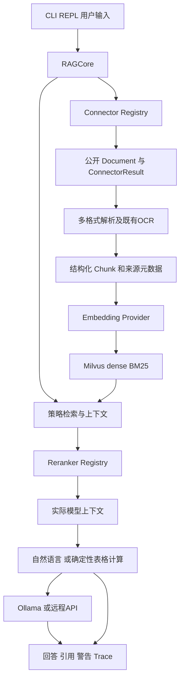
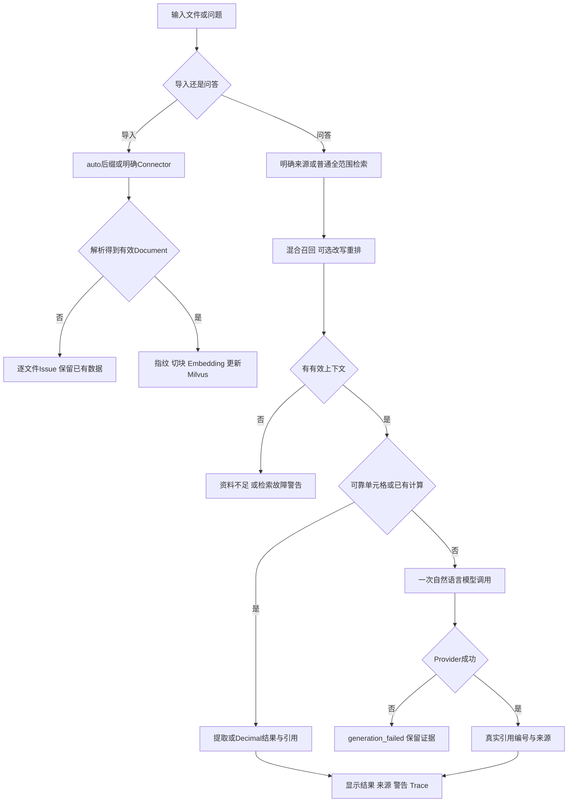

# RAG Multidocs 系统设计

本系统面向需要查询多格式本地资料的教师、学生与项目组成员。用户导入文件后，通过统一入口获得相关原文、自然语言回答和可追溯来源。最终B候选已由用户多轮人工验收后选定；本文描述实际实现，核心开发结束，不把剩余局限写成待执行开发计划。正式发行仍需团队Review、CI和制品核验。

## 1 项目概述与需求

核心场景为“用户选择本地资料，经插件解析、统一索引和检索问答，得到能对照原文的结果及必要错误提示”。基础链路复用原始开源main f38a46d的文档模型、Milvus混合检索和自然语言回答，扩展贡献集中于Connector/Reranker双扩展点、统一RAGCore、多模态结构化解析、来源与运行管理。

必要需求包括普通文本多事实、单/跨文档问答、PDF和扫描件文字、Office和CSV表格、数值/单位保持、来源引用、基础算术、资料不足说明。完成条件是实际答案正确、覆盖所问事实、引用对应原始来源；程序status和测试数量不能替代人工核验。长文局部召回及跨文档漏引仍有失败，当前候选不承诺任意复杂推理。

任务书要求一个完整核心场景、至少一种公开扩展机制和独立扩展、正常及边界/失败/扩展测试、真实协作和可追溯发布。双插件是本项目已有工程成果，不意味着课程要求两套复杂扩展框架。任务书不要求SQLite版本Catalog、审核平台、登录、多租户、热加载或Agent，本项目不因答辩而额外增加这些机制。

责任边界为：RAG Core及多模态负责人维护公开服务和解析扩展；CLI同学维护交互、参数及展示；实际独立扩展贡献归属、Review、CI与发行由团队确认。历史提交及当前差异不自动证明个人归属，README保留待成员填写的真实贡献与审查记录。

## 2 总体架构

核心只通过公开契约与扩展协作。Connector把输入转为Document，切块与入库由宿主完成；Reranker只排序既有候选ID，不能改原文。Embedding和Chat保持Provider边界，Milvus负责向量与文本索引持久化；CLI依赖RAGCore/Runtime，不需要耦合解析器或重排进程内部。

正常Milvus路径不创建SQLite Catalog，不对检索施加旧版本快照过滤。旧Catalog和GroundedQA源码保留兼容，但不是当前默认数据库或生成协议。当前自然语言通常一次生成，可靠单元格和有限运算可零生成；实际上下文、原始模型输出与最终来源各有独立字段，不能把候选集合当作已发送证据。

关键词后端仍支持离线与CLI故障回退，需明确其数据文件与Milvus集合独立。直接服务工厂不自动回退，避免悄悄换库；CLI按现有配置决定并显示warning。这些路径差异属于真实现有行为，接口文档明确列出。

## 3 模块与业务职责

| 代码位置 | 职责 | 与上层的边界 |
|---|---|---|
| config.py services.py core.py | 配置、组装、导入检索问答、资源生命周期 | 不依赖CLI交互内部 |
| connectors/registry.py 与外部connectors目录 | 发现、启停、依赖检查及解析调用 | 返回统一文档和错误 |
| ingestion/ | 文件枚举、结构化切块、指纹、更新 | 不按具体题目生成答案 |
| index/milvus.py milvus_store.py | 元数据/Chunk存储、dense和BM25召回 | 不承担语义事实认证 |
| retrieval/ | 策略、来源范围、融合、邻近与上下文预算 | 分数不是正确概率 |
| rerankers/及外部rerankers目录 | 契约验证、轻量/进程/常驻执行 | 只回传ID rank score |
| qa/llm.py calculations.py | 简洁Prompt、来源、单元格与有限Decimal | 普通语言不强制旧审核协议 |
| cli/ | 命令、REPL、配置切换、答案及Trace展示 | 复用既有Runtime与Core |

TXT为内置Connector；Markdown、HTML、JSONL、PDF、Image、Word、Excel为独立适配目录。通用pdf插件优先级较低，auto可选更专用的Office/Image解析；CSV在Excel插件内使用标准库csv，不增加模型或新依赖。

原生PDF/Word/Excel通过已有docparse或Office结构服务，扫描PDF/图片调用既有OCR。解析保留原始文字、页码、标题、表头、行列、空字段和可用坐标。派生retrieval_text与原始quote分开，不能把检索增强语句伪装成原文。复杂布局和视觉关系超出现有文字/布局能力时保留限制，不补造结构。

## 4 扩展契约与独立接入

公开协议位于rag_multidocs.contracts与model。Connector函数为load(payload, context=None)，payload含name/path/options，返回ConnectorResult(documents, issues)。Document含doc_id/source/content/title/media_type/metadata/segments；宿主负责后续Chunk、Embedding与索引。单条解析问题返回ConnectorIssue(code,message,source)，整体抛错由Registry反馈，不应拖垮其他文件。

Reranker函数rank(request)接收RerankRequest(query,candidates,config,contract_version)。候选为SearchHit不可变元组；输出RankedCandidate(candidate_id,rank,score)必须覆盖所有原ID且无重复，rank为1..N、score有限且在0..1内，次序一致。宿主按ID回联真实原文；无效输出、超时或异常回退本阶段输入顺序并告警。

Manifest定义name/kind/version/contract_version/entry/enabled/requires/config，Connector另有file_extensions/auto_priority。宿主允许列表优先于Manifest默认；复制目录后必须配置并重启，不提供热加载或自动安装。input_schema/output_schema是说明性元数据，不能声称宿主执行了通用JSON Schema审核。

现有独立示例connector.jsonl按UTF-8逐行读取text/source/title，可含公开blocks，坏行RECORD_ERROR与其他成功记录并存；不改Core即可导入新JSONL。独立Reranker示例custom按配置词调整排序，只依赖公开RerankRequest/RankedCandidate。它证明扩展可接入，不宣称通用算法更优或自动等同某成员贡献。

Reranker默认spawn进程，超时可回收。可信Lightweight只有宿主批准精确路径后同进程；其阻塞不能任意强杀。CLI对CrossEncoder精确路径授权一个串行常驻Worker，模型在进程内缓存；配置不等于插件自授权。close回收资源，失败重启受现有次数限制。插件是受信本地代码，不是恶意代码沙箱。

## 5 关键流程与错误分支

导入支持单文件、多路径与递归目录。相同来源和处理签名可命中缓存返回unchanged；内容变化沿用稳定身份更新，先准备Embedding/新记录再清旧余块，普通异常尝试恢复旧文档。多文件不是一个事务，部分失败不能清空整库。首次解析或更新失败均应向用户反馈具体文件和Issue。

问答中普通自然语言不由模糊主题/字段匹配强制限定文档；准确文件名、路径、引号完整标题或公开doc_ids可明确范围。权限与远程授权需由宿主检索前隔离，不能只在回答后删除私人文本。候选经现有策略重排和有限上下文预算，再组织实际Prompt；原文块过大可跳过，不因此丢掉后续所有有效块。

可靠表格字段只有真实匹配所问列才直接返回，字段缺失回自然语言。既有同单位合计/差与显式二元运算使用Decimal，派生结果注明不是原文；只有返回操作数而未完成计算时不能报告计算成功。自然语言没有通用数值/实体审核，引用范围检查不能代替事实核验。

## 6 数据 存储与配置

Document是解析结果，Chunk是索引与引用单位。Chunk含id/doc_id/text/source/index/content_type/section_path/page/page_end/bbox/block_ids/metadata；来源ID与逻辑source有关，移动配置根或命名空间可能产生新身份。结构化表格在segments.meta中保留table_data、header_rows、cells和semantic_cells；单元格值保持字符串，不为计算先转换为浮点。

Milvus主要记录Chunk ID与文档ID、来源、正文、dense向量、BM25稀疏表示和结构元数据；文档元数据/IR以已有payload机制保留，list_documents/document可查询。正常集合只包含其当前数据，不把旧集合历史行解除过滤后混入。纯Milvus不暴露原Catalog版本回滚；recover/cleanup明确报能力不支持，不伪称数据库事务恢复。

更新和缓存使用文件/正文摘要、解析代码、插件与分块设置等处理指纹，解析器修复后正常更新可以获得新内容，无需清库。普通写异常有补偿，不能保证任意主机断电、进程崩溃或并发写入下的事务隔离。Milvus负责持久化，persist无需再写同一份index.json。

Settings从JSON及环境覆盖读取，数据目录、集合、Embedding模型/维度必须匹配现有库。Chat预算通过已有Provider自动适配，显式窗口/输出可覆盖；不会因为换对话模型自动重建索引。凭据不由Core隐式加载，CLI启动apply_keys，库调用需显式处理；相对凭据路径按CWD解释。API Key、私人原文、Prompt、模型权重及数据库不进入Git。

## 7 策略 测试与质量

Stable默认沿用混合召回、无重排及现有邻近补足；Lightweight增加轻量重排，Quality增加CrossEncoder。Experimental启用已有自适应预算、覆盖/MMR、改写与二次检索；按问题选择轻量或CrossEncoder，调用仍受上限约束，不保证每题触发所有机制。四策略共用普通自然语言及可靠表格/计算，不分别建立复杂审核系统。

候选与上下文数量、证据Token和模型窗口各有上限。常规Stable/Quality通常24候选、4块/2000证据token，摘要可6块/3000；Experimental事实/解释/综合通常12/24/48候选及2/4/6块。排序分数是阶段信号，不是事实正确率；未校准低分不再直接删除已排序证据。具体资源以实际Trace为准。

测试覆盖正常文本、结构单元格/数值、坏文件/编码/缺依赖、禁用和抛错插件、Reranker输出契约、超时释放以及Core/CLI接线。用户JSONL专项取得1 passed in 0.16s，并反馈全新JSONL真实导入问答完成；没有取得的三题逐题日志不编造。现有CI包含离线测试/静态检查及Milvus集成，但最新候选尚未运行远程CI，制品构建与发布仍待团队。

用户真实验收中，Ollama Quality为6通过/1部分/1失败；DeepSeek Quality两轮21/22完整通过；Experimental全新语料11通过/1部分/0失败，额外4题单独为2通过/1部分/1失败。本地混合库与远程授权隔离库不同，不能做严格单变量模型对比或宣称总体准确率。来源识别/长文整体预算和方法精度问题明确保留，不用answered掩盖。

## 8 设计取舍 局限与交付

第一项取舍是复用原自然语言链路，退出普通问题必经的任务JSON、逐字摘录及复杂审核回路。它减少正确原句被格式或数值词表误删的问题，但不自动消除模型幻觉。保留Prompt的证据约束、真实编号和来源，可靠结构读取另行验证，不以轻量规则宣称通用事实审核。

第二项取舍是正常运行采用纯Milvus，不再依赖额外SQLite Catalog及双库一致性。已有Milvus元数据承担文档查询/更新，降低调用链干扰；代价是没有旧Catalog的活动版本事务恢复。旧代码和原始数据留作保障，不承诺越过实际能力边界。

第三项取舍是保留结构化单元格读取与Decimal，而不全部交给自然语言。可靠字段、小数、空值和基础算术能保持确定性；缺字段/不可靠操作数应回退或说明，不能发展成通用表格推理引擎。第四项工程选择是常驻CrossEncoder降低重复加载，但只在宿主授权范围运行，仍保留超时与回退，不构造并发Agent系统。

剩余局限包括长文细粒度召回、整体属性覆盖、偶发跨文档漏引、模型混实体或无依据内容，以及OCR复杂视觉关系。answered不代表完整语义验证。项目不实现通用权限/多租户、任意图理解、复杂数学、插件市场、热加载或多轮Agent。

最终工程保持源码与B快照一致，文档/历史整理独立进行。任务书的真人贡献及Review、最终Commit/Tag、CI真实成功、可运行制品、完整Git历史ZIP和新目录解压运行仍由团队核实完成；本轮只准备提交，不擅自commit/push/发布。详细接口、插件协议、验收和追踪矩阵分别见同目录文档。
