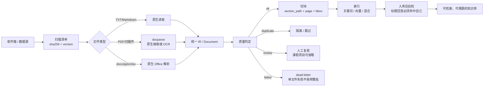

# 多模态文档入库流水线

> 来源：原工程 `new1` 的 `任务二/README.md`、
> `dags/docflow_ingest.py`、`任务二/docflow/manifest.py`。
> 本文只保留与课程 RAG 项目相关的设计，不介绍 Airflow 的调度细节。

## 1. 解决什么问题

真实课程资料不是干净文本：论文是 PDF，讲义是扫描件，笔记是 Markdown，说明是 Word。
直接扔进 RAG 会遇到三类问题：

1. 扫描件没有文字层，检索不到；
2. 表格、公式被字符切分器切碎，答案找不到依据；
3. 命中后只有一段文本，无法指出“来自哪个文件的哪一页”。

原项目把“入库”当成一条可重跑的生产线：**发现 → 解析 → 质检 → 切块 → 索引 → 自检**，
每一步都有明确的输入输出和失败语义。课程项目不需要 Airflow，但这套阶段划分和
数据结构可以直接复用。

## 2. 总体流程



对应到原 DAG 的任务：

```text
scan_inbox → check_services → parse_doc(动态展开)
           → assess_doc → split_docs
           → chunk_doc → index_doc → verify_doc
           → summarize_doc（旁路）
           → dead_letter / notify_review → ApprovalOperator（旁路）
           → digest（汇总）
```

## 3. 每个阶段做什么

| 阶段 | 输入 | 输出 | 关键约束 |
| --- | --- | --- | --- |
| 发现 | 数据源文件集合 | 新增/变更/删除列表 | doc_id 由相对路径派生；内容变化只升 version |
| 解析 | 单个文件 | docparse IR（JSON）+ Markdown | 有文本层的 PDF 不送 OCR；扫描页才走 VLM |
| 质量判定 | IR 摘要 | ok / review / duplicate / failed | 判定顺序固定，先失败、再去重、再质量门 |
| 切块 | IR 或纯文本 | `Chunk` JSONL | 标题进 section_path；表格/公式整块；id 确定 |
| 索引 | chunks | 倒排索引或向量集合 | 按 doc_id 先删后插，重跑不产生重复 |
| 自检 | 已入库文档 | 命中自己的记录 | 用标题回查 top-k，必须包含自己的 doc_id |
| 汇总 | 各阶段结果 | 统计与报告 | 失败文件被隔离，不影响其他文件 |

## 4. 状态机

原项目用 SQLite 维护文档状态，课程项目可以只保留其中几个：

```text
NEW ──解析成功──> PARSED ──切块/索引成功──> INDEXED
 │                   │
 │                   └──质量门未过──> NEEDS_REVIEW ──批准──> PARSED
 │
 ├──解析失败──> FAILED
 ├──近重复────> DUPLICATE
 └──源文件删除─> DELETED
```

可复用实现见 `代码/manifest_store.py`。它提供：

- `scan(files, root)`：新增 / 变更 / 删除；
- `mark(doc_id, status, **fields)`：状态与统计字段；
- `pending()`：续跑上次未完成的文档；
- `events(doc_id)`：每次状态变化的事件流；
- `indexed_fingerprints()`：只把成功入库的文档作为去重基准。

## 5. 质量门判定顺序

原项目的顺序很重要，课程项目可以照搬：

1. **解析失败**（退出码非 0）→ `FAILED` → 隔离，不重试坏文件；
2. **近重复**（SimHash 汉明距离 ≤ 10）→ `DUPLICATE`，同批次也互查；
3. **空页率 > 30%** 或 **字符数 < 80** 或解析器标记 `needs_review` → `NEEDS_REVIEW`；
4. 其余 → `OK` → 切块入库。

阈值来源：`任务二/docflow/config.py`。阈值不是绝对标准，上线前应在自己的样例集上校准。

> 课程项目如果不做人工复核，第 3 步可以直接记为 `SKIPPED/FAILED` 并在结果里返回原因，
> 但必须在 README 说明“低质量文档不会入库”，不能静默丢弃。

## 6. 失败语义

| 场景 | 原项目行为 | 课程项目建议 |
| --- | --- | --- |
| 单个文件解析失败 | 返回失败状态，走 dead-letter，其他文件继续 | 返回该文件的错误条目，整批仍成功 |
| 解析服务不可用 | 抛基础设施异常，Airflow 重试 | 明确报“服务不可用”，提示重试 |
| 文件不存在/不可读 | 400/404，记录错误 | Connector 返回结构化错误，不崩溃 |
| 空数据源 | 正常结束，统计为 0 | 正常返回空结果，并提示“没有可导入文件” |
| 索引服务不可用 | 任务重试 | 保留已切块结果，返回“索引失败，可重试” |

关键原则：**一个坏文件不能拖垮整批**；但“部分成功”必须如实报告，不能吞掉错误。

## 7. 幂等设计

原项目用三个机制保证重跑安全：

1. `doc_id = sha256(相对路径)[:12]`：路径稳定，换机器不变（不要用绝对路径）；
2. `sha256(文件内容)` 存在清单里：内容没变就跳过解析/索引；
3. `chunk_id = sha1(doc_id:类型:序号)[:20]`：切块结果可复现；
   索引时按 `doc_id` 先删后插，重跑不会产生重复向量。

课程项目至少应实现第 1、3 条；第 2 条可以用 `manifest_store.py` 直接获得。

## 8. 数据布局（原项目）

```text
data/docflow/
├── inbox/                   # 唯一输入目录
├── raw/<doc_id>/            # docparse IR JSON + Markdown
├── chunks/<doc_id>.jsonl    # 切块结果
├── meta/<doc_id>.json       # 标题/年份/DOI/语言
├── summaries/<doc_id>.md    # 每篇摘要
├── citations/<doc_id>/      # 按 bbox 裁的原文截图
└── manifest.db              # 状态机
```

课程项目可以简化为：

```text
data/
├── docs/                    # 原始资料
├── index/                   # 倒排索引或向量库
└── manifest.db              # 可选：增量入库清单
```

## 9. 对课程项目的可迁移点

| 原设计 | 课程项目是否采用 | 说明 |
| --- | --- | --- |
| 统一 IR + 切块 | 采用 | `document_model.py` + `chunking.py` |
| SimHash 去重 | 采用（可选） | `dedup.py`，纯标准库，测试成本低 |
| SQLite 清单 | 建议采用 | `manifest_store.py`，演示增量更新很直观 |
| 质量门阈值 | 采用思想 | 保留“空文档/过短文档不入库”的检查 |
| 人工复核/邮件通知 | 不采用 | 课程范围外，增加无关复杂度 |
| Airflow 编排 | 不采用 | CLI 顺序执行 + 错误返回即可 |
| Milvus 混合检索 | 可选 | 见 `04-Milvus混合检索.md` |
| docparse 多模态 | 可选 | 作为额外的 PDF Connector，见 `02-文档模型与IR.md` |
